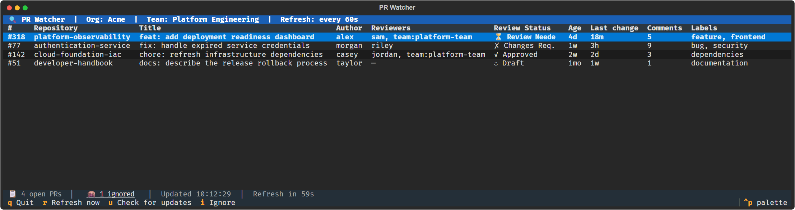

# ecm-pr-watcher

A terminal-based (TUI) dashboard for monitoring open Pull Requests across all repositories belonging to a GitHub team. Built with [Textual](https://github.com/Textualize/textual) — runs entirely in your terminal with no browser required.

## Screenshot



The screenshot uses representative sample data and shows the current table
columns, review states, ignored-PR count, refresh status, and keyboard shortcuts.

## Prerequisites

- **Python 3.10+**

  > **Windows:** The easiest way to install Python is via the Microsoft Store:
  > ```
  > winget install Python.Python.3.12
  > ```
  > Or download the installer from [python.org](https://www.python.org/downloads/). Make sure to check **"Add Python to PATH"** during installation, then restart your terminal.

- **GitHub CLI (`gh`)** — [install here](https://cli.github.com/) and authenticated via `gh auth login`
- Access to the target GitHub organisation and team

## Installation

```bash
# Clone the repository
git clone https://github.com/Equinor/ecm-pr-watcher.git
cd ecm-pr-watcher

# Create and activate a virtual environment (recommended)
python -m venv .venv
# Windows
.venv\Scripts\activate
# macOS / Linux
source .venv/bin/activate

# Install dependencies
pip install -r requirements.txt
```

## Usage

```bash
python main.py --org <GITHUB_ORG>
```

### CLI Flags

| Flag | Default | Description |
|------|---------|-------------|
| `--org ORG` | *(required unless configured in the file)* | GitHub organisation name |
| `--team NAME` | `"ECM WO Preparation"` | GitHub team display name |
| `--team-slug SLUG` | *(derived from `--team`)* | GitHub team slug — auto-derived if omitted |
| `--interval SECONDS` | `60` | Auto-refresh interval in seconds |
| `--bell` / `--no-bell` | `--bell` (on) | Ring terminal bell when new PRs appear |

### Examples

```bash
# Watch the default ECM WO Preparation team
python main.py --org Equinor

# Use a different team with a 30-second refresh and no bell
python main.py --org Equinor --team "My Team" --interval 30 --no-bell

# Provide the slug directly (skips slug derivation)
python main.py --org Equinor --team-slug ecm-wo-preparation
```

## Keyboard Shortcuts

| Key | Action |
|-----|--------|
| `q` | Quit the application |
| `r` | Force an immediate refresh |
| `u` | Check the current Git branch for updates and restart if it changed |
| `Enter` | Open the selected PR in the default browser |
| `i` | Ignore the selected PR for `ignore_days` days. In the ignored view the footer label changes to **Restore PR** and `i` restores it |
| `↑` / `↓` | Navigate the PR list |
| `Ctrl+C` | Quit the application |

The update check requires a clean Git worktree and runs `git pull --ff-only`
against the current branch's configured upstream. Python does not keep imported
source files locked, but a running process keeps the old code in memory. When
`HEAD` changes, the app exits cleanly and restarts the original Python command
so the updated modules are imported.

Click **🙈 N ignored** in the status bar to switch to the ignored-PRs view (the Age column shows when each ignore ends); click it again to go back.

Hover over clipped table cells to see their full text in a tooltip, including
repository names, titles, authors, reviewers, and labels. This requires a terminal
with mouse-motion support, such as Windows Terminal.

## Reviewers

The **Reviewers** column beside **Author** shows requested reviewers and people
who have already submitted a review, with duplicate names removed. Requested
teams appear as `team:<slug>`. PRs without reviewers show `—`.
Copilot reviewers are excluded from this column.
The column is capped at 30 characters and shrinks on narrower terminals to
preserve space for the title.

## PR checks

The **Review Status** column starts with a green circle when checks on the PR's
latest commit succeed, or a red circle when they fail or report an error.
The indicator stays blank while checks are running, pending, unavailable, or
indeterminate. The review status text remains beside it.

## Last change

The **Last change** column shows how long it has been since GitHub last updated
the PR, using the same minute/hour/day/week/month granularity as **Age**. This
timestamp reflects PR activity such as commits, comments, reviews, and metadata
changes.

## Configuration

All CLI options and display preferences can be set in a local `pr-watcher.json` file in the repository root. Command-line flags override the corresponding file settings; omitted settings use the defaults above. This file is ignored by git. If it is missing, pass at least `--org` on the command line. To get started, copy `pr-watcher.example.json`:

```bash
cp pr-watcher.example.json pr-watcher.json
```

The example uses the options from the `--org Equinor --team "My Team" --interval 30 --no-bell` command above, with the corresponding team slug and priority sorting. Replace the team name and slug with your team's values. Once `org` is configured, launch without any arguments:

```bash
python main.py
```

| Setting | Default | Description |
|---------|---------|-------------|
| `org` | *(required in the file or via `--org`)* | GitHub organisation name |
| `team` | `"ECM WO Preparation"` | GitHub team display name |
| `team_slug` | *(derived from `team`)* | GitHub team slug; omitted or empty values are auto-derived |
| `interval` | `60` | Auto-refresh interval in seconds (integer), corresponding to `--interval` |
| `bell` | `true` | Ring terminal bell when new PRs appear; use `false` for `--no-bell` |
| `sort` | `"created"` | Row order. `"created"` shows the newest PRs first. `"updated"` shows the most recently changed PRs first. `"priority"` groups PRs as: Review Needed or No Reviews with no reviewers assigned, Review Needed or No Reviews with reviewers, Changes Requested, Approved, then drafts. Copilot does not count as a reviewer. Within each group, the oldest PR comes first. |
| `ignore_days` | `14` | How many days a PR stays hidden after you press `i` on it. Must be a whole number from 1 to 3650. |

The app refuses to start if the file contains invalid JSON, unknown settings, or wrong value types.

Ignored PRs are saved in `pr-watcher-state.json` in the repository root. The app manages this file and git ignores it. An ignored PR reappears automatically when its ignore period ends. If the file becomes unreadable, the app shows a warning, starts with no ignored PRs, and overwrites the file the next time you ignore a PR.

**How the app works:**

1. Uses `gh api` to list all repositories the target team has access to.
2. For each repository, runs GraphQL PR queries concurrently (up to 5 parallel calls) to fetch open PRs.
3. Refreshes automatically at the configured interval.
4. Retains previous rows for repositories whose refresh fails and marks them as stale.
5. Rings the terminal bell when PRs appear that weren't present in the previous fetch.

> The app relies entirely on the authenticated `gh` CLI — no personal access tokens or secrets are needed beyond a normal `gh auth login`.

## Contributing

1. Fork the repository and create a feature branch from `main`.
2. Make your changes with tests where applicable.
3. Open a Pull Request — fill in the PR template and request a review from `@Equinor/ecm-wo-preparation`.
4. Ensure all checks pass before merging.

See [PULL_REQUEST_TEMPLATE.md](.github/PULL_REQUEST_TEMPLATE.md) for the full PR checklist.

## Licence

Internal Equinor project. See your organisation's standard licence terms.
